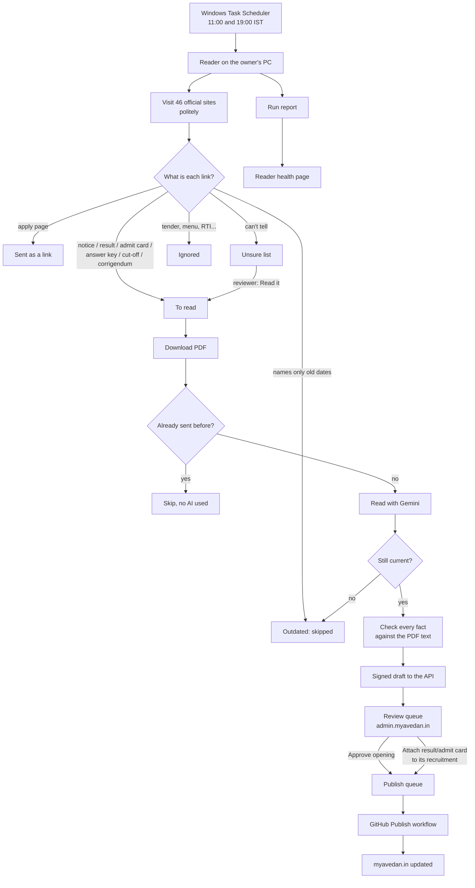

# How MyAvedan finds, reads and queues notices

This explains, start to finish, how a government recruitment notice gets from an official website onto myavedan.in: how the reader finds it, how it decides what it is, how it reads it, and how it waits in queues until a person checks it and it is published. It also explains the choices we made and why.

For setup steps see [PC_RUNNER.md](PC_RUNNER.md) (the PC that runs the reader), [REVIEW_CONSOLE.md](REVIEW_CONSOLE.md) (sign-in and reviewers) and [PUBLISHING.md](PUBLISHING.md) (secrets and the publish workflow).

---

## The whole journey at a glance

---

## 1. Where notices come from

- **Only official sources.** The list lives in `pipeline/sources/national-north.json`: 46 approved sites for central recruitment (SSC, UPSC, railways, banks, defence and paramilitary forces) and North India (UP, Rajasthan, Uttarakhand, Himachal, Punjab, Haryana, Delhi, Chandigarh, J&K, Ladakh). Each has its official address and the hosts its documents may come from.
- **Why not copy from job-aggregator sites?** They copy each other, make mistakes, and we can't prove where a fact came from. Every fact on MyAvedan must trace back to the official PDF, so we read the official sites ourselves.
- **Why the reader runs on a PC in India.** Many government sites don't answer computers abroad: from GitHub's US servers only 20 of 51 sites answered, from India 37 of 51.

## 2. When it runs

- **Windows Task Scheduler** on the owner's PC starts `pipeline/scripts/run-reader.ps1` at **11:00 and 19:00 IST**. If the PC was asleep or off, it runs as soon as it's back.
- Before each run it pulls the latest code from `main` (only if the project folder is on `main` with no local changes).
- Each run writes a log to `%USERPROFILE%\.myavedan\logs\` (the last 60 are kept).
- *Why not GitHub Actions?* We tried a GitHub runner on the PC first, but GitHub's connection to it dropped during long runs and GitHub then stopped the reader halfway. Task Scheduler has nothing in between.

## 3. Visiting the sites politely

For each site (`discover.py`, `scan_source`):

- **robots.txt is respected.** If a site says no, we don't fetch.
- **2 seconds between requests** to the same site.
- **Conditional requests.** We send back the site's `ETag` / `Last-Modified`; an unchanged page costs almost nothing and is reported as "No change".
- **Old certificates.** Many government sites have broken security certificates. If the secure fetch fails for that reason, the page is fetched once more without the check, and every draft from it carries a warning so the reviewer opens the notice from the official site themselves.
- **Sites that keep failing** (4 failures in a row) are paused and retried every 3 days instead of every run.
- **Pages built by JavaScript** (very few links in the HTML) are reported as "Needs custom reader". These sites (SSC, SBI, RBI, NTA and a few others) need their own reader later.

## 4. Deciding what each link is

Every link on the page that points to one of the source's official hosts is classified by its text and address (`classify`):

| Looks like | Becomes |
| --- | --- |
| result, merit list, selected candidates, marks | **result** |
| answer key, response sheet | **answer key** |
| admit card, call letter, hall ticket | **admit card** |
| cut-off | **cut-off** |
| corrigendum, addendum, date extension | **corrigendum** |
| apply online, registration, candidate login | **apply link** |
| recruitment, advertisement, notification, vacancy | **notice** |
| tender, auction, RTI, transfer order, syllabus, fraud warning | ignored |
| "View all", "More", "Archives" | ignored (list pages, not documents) |

Then:

- **Outdated before reading (free).** If the link names only dates more than ~5 months old, or only years before last year, it is marked *outdated* and never read or listed.
- **First visit to a site.** Everything already on it goes to a **backlog** instead of being read all at once. Later runs read a few backlog items per run, most likely-current first (PDFs, "notification/advertisement", this year's date).
- **Later visits.** New links are read in the same run.
- **Apply links** need no reading; they are sent in one batch and the API suggests which recruitment they belong to.
- **Unsure links.** A link that matches nothing above but looks like a document (a PDF, or text that mentions a year, exam, post, selection, interview...) and isn't a site menu goes to the **Unsure list** (see section 9). Nothing is dropped silently. The first scan of a site with this feature only records what's already there; only links that appear afterwards are listed.
- **"View" / "Download" links.** Many sites put the title and date in the table row, not in the link. When a link's own text says nothing, the reader uses its row's text instead, and a date found only in the row is added, so the type and age checks work.
- **List pages.** Besides its main address, a site can have extra list pages to watch (`extra_pages` in the sources file), e.g. DSSSB's notifications and results pages and HPSC's announcements page. On the first visit to a page, only items dated within the last month are read; older ones are remembered and left alone.
- **Rotating links.** Some sites (CISF) give the same document a new random address on every visit. Those links are recognised by their title instead, so they aren't read twice.

## 5. What the reader remembers

`%USERPROFILE%\.myavedan\reader-state.json`, outside the project folder so clean-ups never erase it:

- every link it has seen and what happened to it: `backlog`, `sent`, `outdated`, `not_pdf`, `already_sent`, `link_sent`, `unsure_sent`...
- each site's `ETag` / `Last-Modified`, failure count and last check
- Gemini calls per day

It is saved after every notice, so a run that is interrupted keeps everything it already sent.

## 6. Reading a document

For each item to read (`cli.py`, `process_bytes`):

1. **Download the PDF** (up to 40 MB). If the link opens a web page instead, the reader finds the notice PDF on that page. Some servers put blank bytes before the PDF header; that's handled.
2. **Already sent?** The file's SHA-256 fingerprint is checked with the API (`/api/ingest/known`) *before* any AI is used. Same file → skipped.
3. **Extract text** page by page with PyMuPDF; scanned pages go through Tesseract OCR (English + Hindi). Pages with no readable text are listed so the reviewer knows.
4. **Compact** the text (drop repeated headers, boilerplate) to use fewer AI tokens.
5. **Gemini reads it** into a fixed structure: what the document is (notice, result, admit card...), title, organisation, advertisement number, summary, every date, every post with vacancies, pay, age limits with relaxations, qualification, other conditions, fees, selection stages, documents. **Every fact must come with the page number and the exact sentence it came from.**
6. **Model fallback.** The main model is `gemini-3.8-flash`. When Google says it's overloaded, the reader waits and retries, then tries `gemini-3.7-flash`, then `gemini-3.6-flash`, and only as a last resort the lite model, whose drafts carry a "check the posts table" warning (it missed posts in testing). If every model is busy, the notice is left for the next run; that's not counted as a failure.
7. **Still current?** An opening whose application window and exam are both over, or a result/admit card whose dates are all more than 60 days old, is marked *outdated* and not sent.
8. **Check every fact against the PDF** (`ground_and_flag`): each quoted sentence must really be on that page, and the value must match the quote. If the AI says 1265 vacancies but the quoted sentence says 1215, the field is flagged as an error. Other checks: age limits that make no sense, dates out of order, links not on official hosts. Problems become **flags** the reviewer sees.
9. **File it by what it is.** If the link looked like a notice but the document is really a result, it's filed as a result, with a warning so the reviewer notices.

### Quota

- At most **40 Gemini calls per IST day** (`GEMINI_DAILY_LIMIT`), counted across both runs.
- Each run reads up to **15 new items + 6 from the backlog**.
- Calls are saved wherever possible: unchanged pages aren't re-read, known files aren't re-read, outdated links are skipped before downloading, apply links use no AI, text is compacted.

## 7. Sending drafts safely

- Every request from the reader to the API is **signed** (HMAC-SHA256 over `timestamp.body` with a shared secret). The API rejects anything unsigned, altered, or older than a few minutes.
- The secret and the Gemini key live only in `%USERPROFILE%\.myavedan\.env` on the PC and in Cloudflare; never in the repository.
- The API (`POST /api/ingest`) checks the draft's shape, that its source is registered, and that the document's host belongs to that source's organisation. Then it stores the document, its version, every page's text and the flags, with state **needs_review**.

## 8. The review queue

At **admin.myavedan.in** (Google sign-in, reviewers only):

- **Queue:** drafts waiting, soonest deadline first.
- **Review screen:** the PDF's text on one side, every extracted field on the other with its quote. Each critical field (dates, vacancies, age, qualification, fees) must be approved or corrected by a person. Nothing goes live otherwise.
- **This document is:** the reviewer can change the type (opening, result, admit card...).
  - **Openings** → *Approve and publish* creates the recruitment page.
  - **Results, admit cards, answer keys, cut-offs, corrigenda** → *Attach and publish*: they're added to their recruitment's page and to the site's Results / Admit cards lists. They never become a new opening.
  - **Other** → can't be published; reject it.
- **Urgent** (for date changes) publishes immediately instead of waiting.

## 9. The Unsure list and Reader health

On **Reader health** in the console:

- **Recent runs:** sites checked and failed, new links, drafts sent, outdated skipped, unsure links, errors.
- **Unsure links:** open each, choose what it is and press **Read it** (it's queued on the server; the next run picks it up, reads it, and sends a draft), or **Not needed**.
- **Official sites:** one line per site. Sites that are unreachable, blocking the reader, built by JavaScript, or quiet for 45+ days are listed first with the reason, so a site that silently stops working can't hide notices from us.

## 10. From approval to the website

1. An approval or attachment adds the document to the **publish queue**.
2. Every 30 minutes (2 hours on production), or at once if urgent, the API asks GitHub to run the **Publish** workflow.
3. The workflow downloads the approved notices, validates them against the site's schema, builds the site and its search index, and deploys it to Cloudflare.
4. It then tells the API, which marks those notices **published**.
5. A nightly rebuild at 00:30 IST keeps "closing soon" and statuses fresh.

If anything fails, the previous site stays live and the queue is retried.

---

## Where things are in the code

| What | Where |
| --- | --- |
| Official sources | `pipeline/sources/national-north.json` |
| Visiting sites, classifying links, outdated / unsure checks, state file | `pipeline/myavedan_pipeline/discover.py` |
| A run: scan, backlog, download, read, send, run report | `pipeline/myavedan_pipeline/cli.py` (`cmd_discover`, `process_bytes`) |
| Gemini prompt, structure, retries, model fallback | `pipeline/myavedan_pipeline/gemini.py` |
| Fact checks against the PDF | `pipeline/myavedan_pipeline/convert.py`, `grounding.py`, `validate.py` |
| Signed requests | `pipeline/myavedan_pipeline/ingest_client.py` |
| Scheduled run on the PC | `pipeline/scripts/run-reader.ps1`, `install-reader-task.ps1` |
| Receiving drafts | `apps/api/src/routes.ts` (`ingest`) |
| Review, approve, attach | `apps/api/src/admin.ts`, `review.ts`; console `apps/admin/src/Review.tsx` |
| Apply / update links | `apps/api/src/links.ts`; console `Links.tsx` |
| Run reports, Unsure list | `apps/api/src/health.ts`; console `Health.tsx` |
| Publishing | `apps/api/src/publish.ts`, `.github/workflows/publish.yml` |
| Database tables | `migrations/0001`–`0004` |

## Known gaps (next work)

- **Custom readers** for JavaScript-built or blocking sites: SSC, UPSC, SBI, RBI, NTA, NVS, HPRCA, Rajasthan Police, rrbapply; and fixing paused sites' addresses (several RRBs, KVS, India Post, DRDO, SSB, Employment News, HPPSC).
- **A second, independent read of critical facts** (dates, vacancies, age, fee), flagged when the two reads disagree.
- **Automatic matching** of results and admit cards to their recruitment by advertisement number.
- **A weekly cross-check** against public listings to spot anything we missed.
